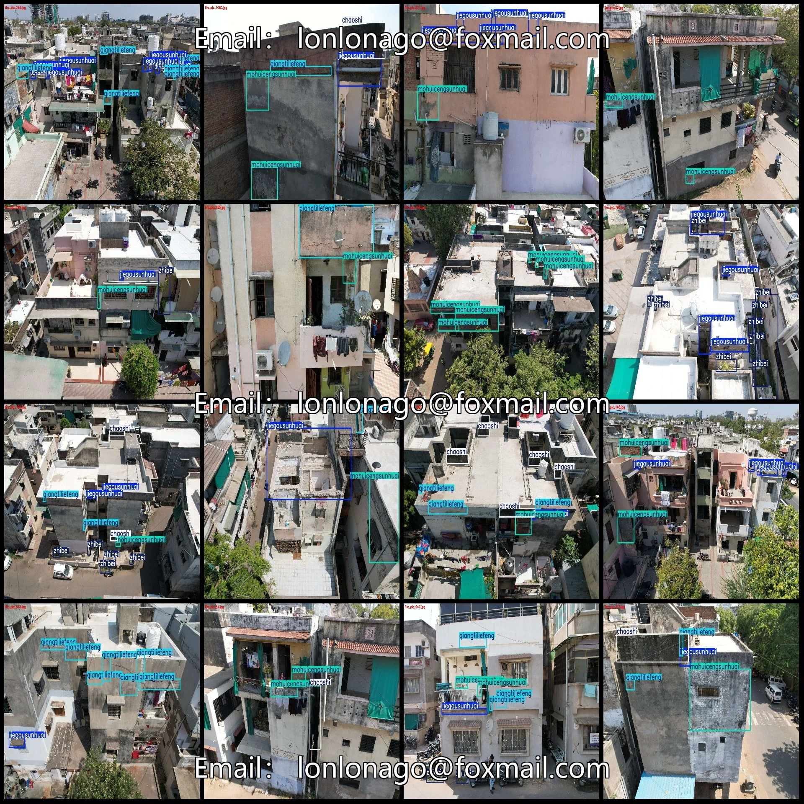
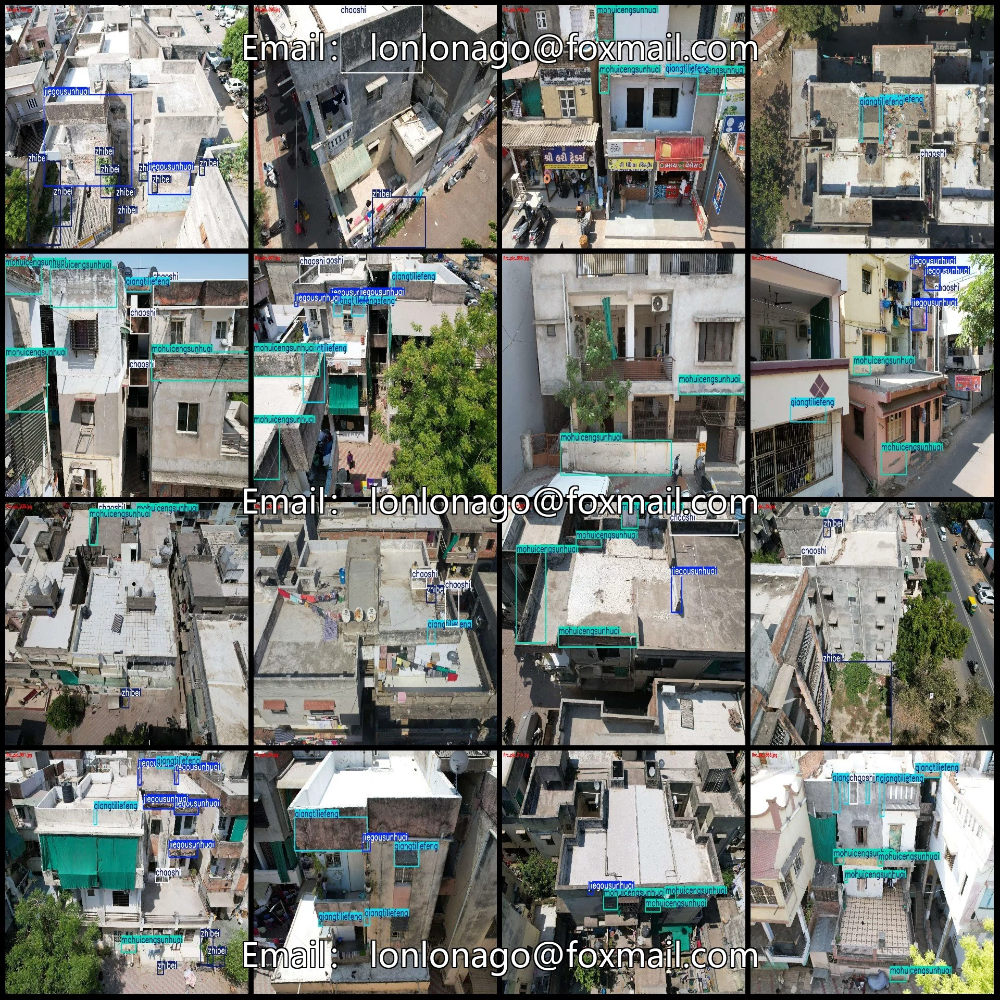
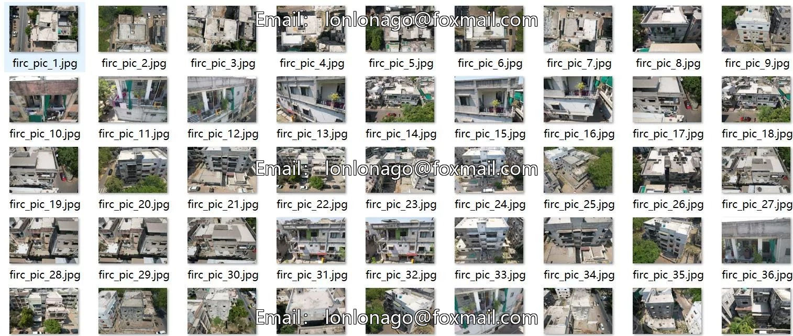
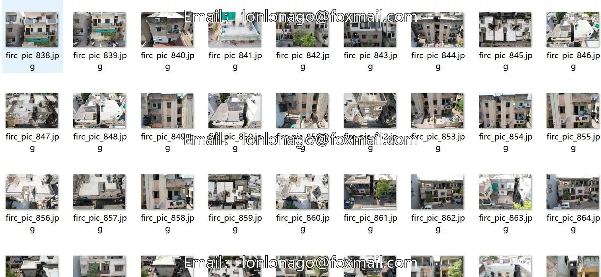
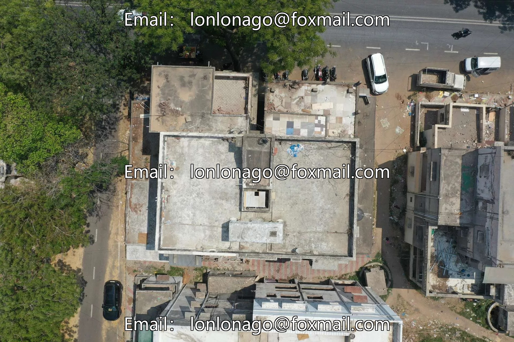
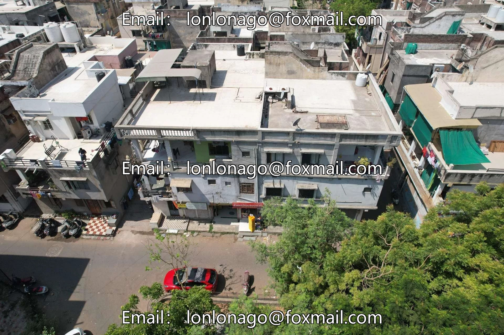
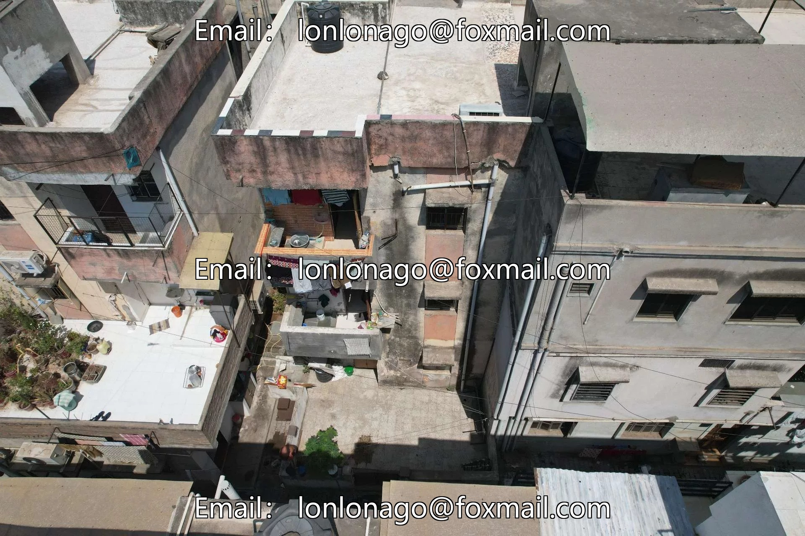

# UAV-viewpoint aerial photography dataset for damage and defect detection of buildings in VOC+YOLO format 1

## Body

Drone-View Aerial Photography Building Defect Detection Dataset - VOC+YOLO Format - 1045 Images in 5 Categories
Warm Reminder: Due to the dataset's replicability, please confirm compliance with requirements before purchasing.
Dataset Format: Pascal VOC format + YOLO format (txt file without split path, only containing jpg images and corresponding VOC format xml files and yolo format txt files)
Number of Images (Total jpg files): 1045
Number of Annotations (Total xml files): 1045
Number of Annotations (Total txt files): 1045
Number of Annotation Categories: 5

Label category names (Note that the order of categories in the YOLO format does not correspond to this, but is based on the labels folder's classes.txt): ["chaoshi", "jiegousunhuai", "mohuicengsunhuai", "qiangtiliefeng", "zhibei"]
Corresponding Chinese category name: ["Moisture", "Structural Damage", "Finish Cracks", "Wall Cracks", "Vegetation"]
Number of boxes labeled in each category
chaoshi Frames = 851
jiegousunhuai Frames = 1647
mohuicengsunhuai frame count = 1831

qiangtiliefeng frame count = 1350
Zhibei Frame Count = 882
Total frame count: 6561
Number of images per category
Chaoshi's total number of images = 429
Jieguosunhuai's possession of images = 620
mohuicengsunhuai occupies the number of images = 740
qiangtiliefeng occupies = 575
Zhibei's number of images = 328
Image resolution: 1920x1280
Using labelImg:
Annotation rules: Draw a rectangle around the category.

Important Notice: The dataset does not have separate training, validation, and test sets; you need to partition them yourself.
Special : This dataset does not guarantee the accuracy of the trained models or weight files.

## Images

## Payment

Here is a pay link on Stripe ( https://buy.stripe.com/3cs8yP7sY87d0vu9AB ). Please contact me lonlonago@foxmail.com after funding $89, and I will send you a complete data files , thank you!

